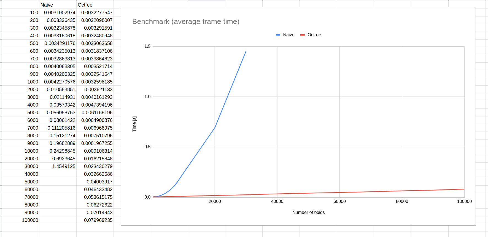

# 3D Boids simulation

[demo](https://ac3d.skippy-ai.com/)

## Local native development

Use `rustup` and run commands from the repository root. `rust-toolchain.toml`
selects the tested Rust 1.95.0 toolchain, including formatting and lint tools.
On macOS, Xcode command-line tools are also required.

```sh
cargo build --release --locked
cargo run --release --locked
cargo fmt --all -- --check
cargo test --release --locked
python3 scripts/smoke-native.py
```

The smoke check opens the app for ten seconds and then closes it. It requires
a desktop session with graphics support; it checks startup, not flocking correctness
or performance. There are currently no Rust unit tests.

`cargo run` supplies the asset root. When running the binary directly, set it:

```sh
CARGO_MANIFEST_DIR="$PWD" ./target/release/autonomous-characters-3d
```

This native baseline retains Bevy 0.9.1 and the existing simulation behavior.
The lockfile updates only `coreaudio-sys` and `bindgen` for current macOS SDKs.
A macOS window-size workaround handles invalid resize events from the old
windowing library until the Bevy/windowing upgrade.

For dependency diagnostics, install the separate CLI with
`cargo install --locked --version 0.20.2 cargo-deny`, then run
`cargo deny --locked --target aarch64-apple-darwin check advisories` on this Mac.
Existing advisories are expected;
this command does not upgrade packages. `samply` is an optional native CPU
profiler; after installing version 0.13.1, run
`CARGO_MANIFEST_DIR="$PWD" samply record ./target/release/autonomous-characters-3d`.
For source line information, first rebuild with
`CARGO_PROFILE_RELEASE_DEBUG=1 cargo build --release --locked`.
Keep profiling separate from uninstrumented performance measurements.

## Sources

Some sources I used for inspiration and help building this.

### Boids

- http://www.red3d.com/cwr/boids/
- https://natureofcode.com/book/chapter-6-autonomous-agents/
- https://dl.acm.org/doi/10.1145/37401.37406

### Octree

- https://en.wikipedia.org/wiki/Octree
- https://magnum.graphics/showcase/octree/?spheres=20&sphere-radius=0.1&sphere-velocity=1.0
- https://castle-engine.io/vrml_engine_doc/output/xsl/html/section.how_octree_works.html

### Language and libraries used

- Rust 1.95.0 (tested local development toolchain)
- Bevy 0.9.1 (game engine)
- Rayon 1.6.1 (multithreading)
- Nalgebra 0.31.4 (linear algebra library)

### Implementation

- The Naive and the Octree implementation include multithreading
- Menu for changing the parameters of the simulation
- Octree is implemented as an "arena allocated tree"
  - [Example 1](https://dev.to/deciduously/no-more-tears-no-more-knots-arena-allocated-trees-in-rust-44k6)
  - [Example 2 - library](https://github.com/fitzgen/generational-arena)
- The Octree is built in every call of the function "flock" - every time we update the speed of the boids

### Analysis

- Results of benchmarks



#### Possible improvements

- Updating of Octree (instead of rebuilding)
- Faster rendering speed (rendering has issues at higher number of boids)
