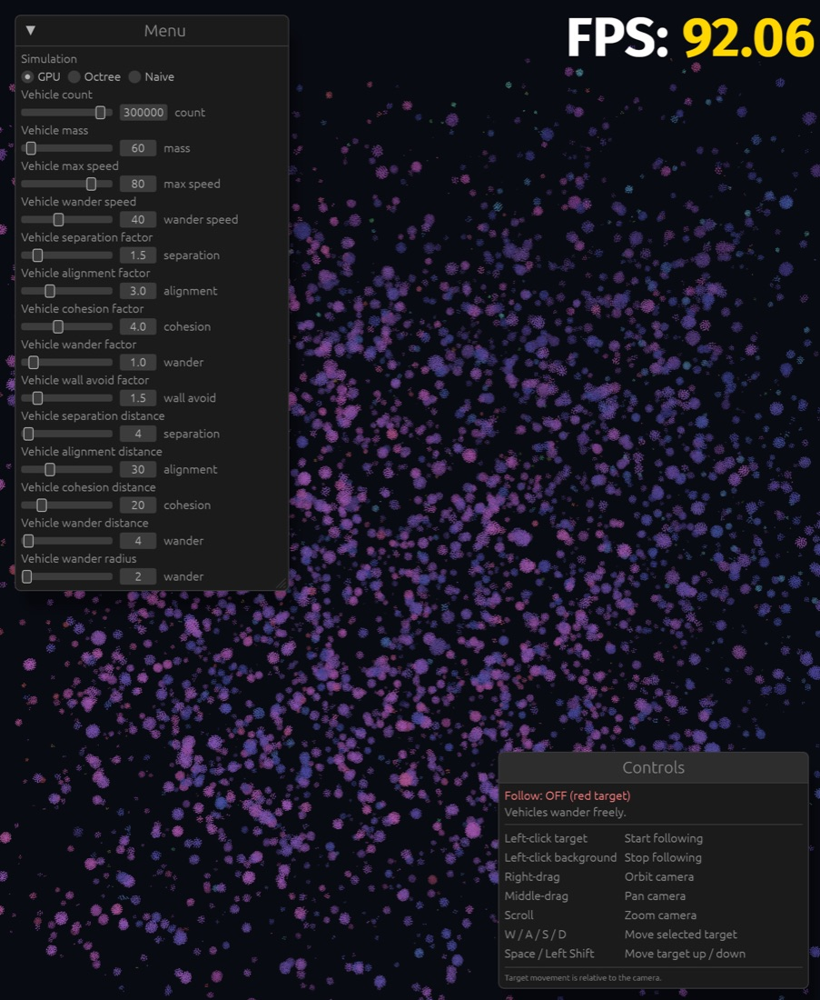

# 3D Boids simulation

A 3D flocking (boids) simulation in Rust and [Bevy](https://bevyengine.org/). Vehicles steer
with separation, alignment, cohesion and wander, and can follow a target you move around.



*300,000 vehicles simulated on the GPU at about 92 FPS (Apple M3 Pro).*

## Project history

### 2022–2023: university project

Built in about a week as a bonus assignment for a university course (first commit December 2022,
web build February 2023). Rust 1.66, Bevy 0.9.1, Rayon and nalgebra:

- naive O(n²) neighbor search and an arena-allocated octree, both multithreaded;
- an egui menu for live simulation parameters;
- vehicles drawn as cones, plus a WASM web build ([original demo](https://ac3d.skippy-ai.com/); removed in 2026,
  still in the `master` history);
- a benchmark comparing the two modes ([chart](meritve.png); slower and less exact than today's numbers).

### 2026: revisited with AI coding agents

Almost four years later the project no longer built on current toolchains. It was picked up again to
see how far today's coding agents (OpenAI Codex and Claude Code, with Claude orchestrating Codex
workers later on) get in a handful of prompts. They upgraded the stack, audited the code, found and fixed bugs,
added tests and benchmarks, optimized it, and moved the simulation to the GPU. I wrote the prompts and
made the decisions; the agents wrote the code, plans and checks.

| | Original (2023) | Now (2026) |
| --- | --- | --- |
| Stack | Rust 1.66, Bevy 0.9.1 | Rust 1.99.1, Bevy 0.20.1, bevy_egui 0.43.1 |
| Builds today | No | Yes (verified on macOS; Linux/Windows setup documented) |
| Simulation | CPU naive / octree | **GPU compute shader (default)** plus CPU naive / octree |
| Vehicles | Slider up to 50,000, naive O(n²) by default | 20,000 by default, slider up to 1,000,000 |
| Rendering | One entity per vehicle | One instanced draw, heading colors, lighting, fog |
| Tests | None | 147 tests, including GPU parity tests and seeded benchmarks |
| Known bugs | 14 audit findings | All fixed except CI, which isn't wanted |

Bugs found and fixed include:
- NaNs from normalizing zero vectors;
- octree queries that checked one leaf and missed neighbors;
- frame-rate-dependent movement;
- a speed clamp that allowed √3× the maximum;
- a mass slider that ignored existing vehicles;
- followers collapsing into a single point.

The audit is [review-report.html](review-report.html). Each fix has an ExecPlan with evidence in
[plans/completed/](plans/completed/), and [plans/STATUS.md](plans/STATUS.md) tracks the open work.

## Run it

Needs [rustup](https://rustup.rs/); `rust-toolchain.toml` installs the pinned Rust 1.99.1. macOS
needs Xcode command-line tools. Linux needs Bevy's system libraries, clang and mold. For a fresh
machine, follow [docs/new-machine-setup.md](docs/new-machine-setup.md).

```sh
CARGO_BUILD_JOBS=4 cargo run --release --locked
```

`cargo run` supplies the asset root. To start the binary directly:
`CARGO_MANIFEST_DIR="$PWD" ./target/release/autonomous-characters-3d`.

### Controls

| Input | Action |
| --- | --- |
| Right-drag / middle-drag / scroll | Orbit / pan / zoom the camera |
| Left-click the red target sphere | Vehicles follow it (target turns green) |
| Left-click the background | Back to wandering |
| W A S D, Space, left Shift | Move the selected target (relative to the camera, real time) |
| Swarm → Predators | Add/remove up to four flee fields; static or simulated Orbit paths, prey-group masks |
| Swarm → Sphere obstacles | Add/remove/edit up to eight spheres; Show toggles wireframes |
| Hold F over the scene | Apply selected Swarm cursor attractor/repulsor; release stops it |
| P | Pause / resume vehicle simulation |
| O | Toggle real-time auto-orbit |
| B | Boid camera: Off → Chase → First person → Off |
| N | Pick a random boid for the camera |
| Scroll while riding | Change chase distance |
| 1 / 2 / 3 / 4 / 5 | Front / side / top / overview / target close-up |

The on-screen Controls panel shows these and the follow state. Camera and target input defer to the
menu when it has focus.

### Modes and settings

- **GPU** (default) keeps every vehicle in GPU buffers. The count slider goes up to 1,000,000.
  **Follow neighbor samples** (default 16, 0 = all) caps alignment/cohesion samples while following;
  separation always sees every close neighbor.
- **Octree** and **Naive** run on the CPU (up to 50,000) and are the tested reference behavior.
- Switching between CPU and GPU respawns the flock. Switching Naive/Octree keeps it. Lowering the GPU
  count truncates the flock; zero clears it.
- The Menu groups controls under **Presentation**, **Simulation**, **Swarm**, **Steering**, **Scene**, and **Vehicles**.
- **Studio** (default) has a vertical navy/indigo sky, a lighter blue horizon, warm key/cool fill
  lighting and a dark blue, rough ground plane. A faint ground grid shares the floor's lighting and
  fog; short corner brackets replace the full wall box. The sky follows the camera, encloses the
  walls, stays inside the far plane and ignores fog/picking. No bloom or per-vehicle lights are used.
- **Classic** retains the original flat background, box/grid colors and layout, lighting, material
  roughness and HSV heading palette. It hides the Studio sky and floor.
- Heading palettes are independent of scene style. Six distinct stops plus a repeated first stop
  make the new palettes continuous around the heading wheel:
  **Ocean** (deep blue, cyan, seafoam, sand, coral, violet), **Dusk** (indigo, magenta, orange, gold,
  rose, purple), and **Aurora** (teal, green, yellow-green, violet, magenta, blue).
  **Aurora** is the default: its green/lime and magenta groups contrast well with the navy sky.
  **Classic** keeps the original HSV function unchanged.
  Changing style keeps the selected palette; choose Classic style **and** Classic palette for the
  original presentation. Studio adds 15% base-color emission alongside its restrained rim term to
  keep distant darts visible. Both styles retain the opaque red/green target and a screen marker
  that remains visible inside dense flocks; click the sphere itself to select it.
- **Auto-frame on count change** defaults on. It waits until the count slider stops changing for
  0.35 seconds and is released, then changes orbit distance while preserving orientation and the
  panned anchor. **Frame world** does the same immediately. Both fit every wall corner; they do not
  track the flock centroid. Classic fog starts beyond the farthest wall. Studio uses gentle depth
  haze colored exactly like its horizon, retaining at least 70% transmission at every wall. Fog
  visibility and the far clipping plane follow the camera, even with auto-frame off. The floor and
  grid scale with the world.
- Simulation defaults live in `GlobalState::default` in `src/main.rs`; appearance defaults live in
  `src/scene.rs`. Physical `vehicle_size` still scales neighbor radii and instance size as before.

Wandering vehicles apply wall steering only after crossing a wall. An outside axis desires inward
max speed; an in-bounds axis retains its current velocity component. The difference is capped at
max speed × wall-avoid factor. Fully in-bounds vehicles receive no wall force, so walls no longer
brake wandering vehicles. Global/group seek and formation wall gating remain unchanged. Walls
steer softly rather than clamp positions, so a vehicle may briefly overshoot. Default speeds and
force weights are unchanged; visual speed tuning remains an owner decision. See
[containment measurements](plans/completed/2026-11-01-wall-containment.md).

### Swarm mechanics

**Swarm → Cursor field** selects **Off** (default), **Attract** or **Repel**. Hold **F** over the
scene to apply the field under the cursor; release F to stop. Keyboard focus or pointer hover in
egui blocks it. F leaves target picking, target movement and camera gestures available.

The cursor ray intersects a camera-facing plane through the current orbit focus, including after
pan/zoom. A cyan attractor or orange repulsor shows its center and influence-radius ring. The point
and gizmo remain live while paused; vehicles respond only when simulation resumes. Strength is
0–20 (default 4); radius is 1–200 reference-world units (default 60), multiplied by
`vehicle::world_scale(count)`. Scenario positions are explicit world coordinates and do not rescale.

For normalized offset `u = (point - position) / radius` and `q = length(u)`, attraction is
`u * max_speed * strength * 6.75 * (1-q)^2` inside the radius, zero outside. It is finite at the
center, reaches `max_speed * strength` at one-third radius and falls smoothly to zero at the edge.
Repulsion is its exact negative. The term adds to flocking and target seek (or wander/walls), is
divided by mass, and uses the same simulated-time integration and final speed clamp on CPU/GPU.
Spatial falloff scales with count; the existing world-unit max speed stays unchanged.

**Groups** is Off by default. Enable 2–8 groups in Swarm, then select **Vehicles → Color → Group**
to use the per-group sRGB colors. Separation sees every group; alignment and cohesion see only the
same group. Each group can optionally seek a world-space target using the existing seek law instead
of wander/walls. Selecting the global target overrides every group target; clearing global follow
restores each group's target or normal wander. The cursor field affects all groups additively.

Other-group neighbors do **not** consume GPU alignment/cohesion samples. Exact separation remains
unfiltered. The configured follow cap applies during global following or whenever an enabled group
has a target (including groups without targets in that scene). With no targets, wander queries stay
unlimited. CPU queries remain exact; GPU capped samples depend on spatial traversal order.
Filling a same-group quota can scan more foreign candidates, especially with rare groups.

Membership uses a stable spawn ID and reserved formation slot in a separate 16-byte metadata table.
GPU Boids stay **64 bytes**. Sorting carries a 32-bit table index; groups Off never reads metadata
in steering. Two metadata tables (one maintenance scratch) and two order maps add 5 MiB at 100k
capacity and 40 MiB at 1M capacity. They share the eighth storage binding with future scene data.
Instance stride stays 48 bytes and the draw count stays one. Animation phase keeps its original bits
and seed formula. Other color modes remain unchanged. Repeated RX 7900 XT headless Off step medians
are within 5% of the original baseline in 100k/1M wander/follow. See the
[swarm plan](plans/completed/2026-10-31-swarm-mechanics.md) for all candidates, timings and limits.

New vehicles use spawn ID modulo the enabled count; Off spawns use dormant ID-modulo-eight
membership. Enabling or changing the group count reassigns every existing member by spawn ID
modulo the new count, once per edit. New groups can receive existing members without vehicle growth. Off preserves latent membership while ignoring group targets/filtering and
writing group zero to instances; re-enabling recomputes assignment from IDs. Contiguous spawn IDs
balance group populations within one vehicle; sparse surviving ID sets have no exact population
quota. Shrinking vehicle count retains surviving IDs/groups;
regrowth uses fresh IDs, rather than sorted indices or reused count values. Zero count and CPU/GPU
backend transitions start a new ID lifetime. Naive/Octree switches preserve membership. Group edits,
colors and membership maintenance remain live while paused; motion still follows the simulation clock.

**Sphere obstacles** start Off (empty list). In Swarm, **Add at origin** creates a sphere; edit its
world center, reference radius and clearance, or use Remove / Clear. Up to eight spheres are allowed.
Orange wireframes show physical radii; faint outer wireframes show clearance. **Show** toggles only
the gizmos. Obstacles remain visible and editable while paused. Strength is 0–20 (default 4);
radius is 0.1–200; clearance is 0.1–200 (default 10). Editing **all clearances** updates existing
spheres and the default for later additions; individual clearance edits affect one sphere.

Avoidance projects each sphere center onto the segment from current position to position + velocity
× one simulated second. At the closest point, the normal points away from the center (+X at exact
coincidence). For surface distance d and clearance c, weight is smoothstep(1-clamp(d/c, 0, 1)).
Inside the sphere weight is one; outside radius + clearance it is zero. Sum weighted normals, clamp
to length one, then multiply by max speed × strength. Radius and clearance multiply world scale;
centers stay in explicit world coordinates. Avoidance adds after the cursor field and before mass
division. Seek, groups, speed/substeps, wall steering and the final speed clamp retain their laws.
This is soft steering: fast vehicles or competing forces can penetrate spheres.

`SwarmScene` owns the list independently of backend/count changes. Naive/Octree switches preserve
vehicles and scene; CPU/GPU switches respawn vehicles and keep the scene. GPU sphere records share
the eighth storage binding after metadata/order maps (256 reserved bytes). Records upload only
on sphere edits or capacity growth. Empty/zero-strength avoidance compiles out of steering;
64-byte Boids, 48-byte instances and the vehicle draw are unchanged.

**Formations** start Off. Swarm offers Sphere / Helix presets, a world center (or **Use orbit focus**),
extent, arrival radius, arrival force cap, morph target and morph speed. Sphere/Helix select blend
endpoints 0/1; active preset changes morph toward that endpoint. The morph target can select any
intermediate shape. Actual morph advances by fractions per simulated second (default 0.25), freezes
on pause and follows simulation speed/substeps. Zero morph speed snaps on the next simulation step.
First enabling selects the requested shape immediately; vehicles still travel to their slots.

Each enabled vehicle has a dense unique metadata slot. Count/group-count edits and enabling rebuild
slots by current record order within each group. Sorts, shape edits and Naive/Octree switches retain
slots; backend switches respawn. Off preserves latent slots and assigns no new ones until enabled.
Groups get separate shapes on an XY grid, spaced 2.25 extents apart. Raising group count keeps the
spawn-ID rebalance policy; groups without members have no shape.

Targets are analytic: a Fibonacci sphere or a three-turn helix, linearly blended. The sphere uses an
integer golden-angle phase so million-slot longitudes retain precision; animation phase is independent.
Extent (default 60) and arrival radius (default 10) scale with world size. For slot offset d, desired
velocity is normalized(d) × max speed × min(length(d)/arrival radius, 1). Arrival force is desired
minus velocity, capped at max speed × strength (default 4). Strength controls the cap, not a gain.
Formation replaces global/group seek and wander, retaining flocking, attractor, obstacles, and walls
where the original branch would wander. Follow selection stays stored and resumes when formation
is Off. Strength zero retains the navigation selection with zero arrival force.

Active formation uses **follow neighbor samples**, even without following; zero keeps the exact
query. Separation remains exact across all groups. Crowding, flocking and obstacles can prevent exact
slot convergence. Eight small group-range records share the arena after the sphere reservation;
there is no dense target array or per-frame scene upload. Off steering compiles formation out.

**Predators** start Off (empty list). Swarm adds up to four visible magenta controls, each with a
world position, reference threat radius and eight-bit prey mask (all groups by default). Strength
(default 4) caps summed fleeing at max speed × strength. Every predator contributes its outward
normal, with +X at coincidence, weighted by smoothstep(1 − clamp(distance / threat radius, 0, 1)).
The sum is capped before weighting. Threat radii scale with world size. Mask bit 0 selects the whole
flock when groups are Off; otherwise bits 0–7 select the corresponding group. Flee adds to navigation,
flocking, attraction, obstacles and formations. Formations deform and regroup after threats leave.
Neighbor caps never hide predators; predators alone do not enable a cap.

Static paths use edited world positions. **Orbit** overrides those positions with evenly spaced
controls on a deterministic XY circle. Path radius (default 50 reference units) scales with world
size; angular speed is degrees per simulated second (default 30). The center follows the enabled
formation center, otherwise the anchored orbit focus. Selecting Orbit captures the camera focus;
**Anchor at orbit focus** updates it explicitly. Scenarios use origin until `predator_center` edits
it. Camera movement cannot move a paused path. Phase freezes on pause and respects speed/substeps;
CPU/GPU use the same position snapshots. Explicit count/center edits may rescale or relocate controls
while paused. Static mode preserves phase; an empty list resets it at the next simulation snapshot. Backend changes preserve scene settings.
**Show** affects gizmos only. Orbit motion does not write scene settings or GlobalState.

Four substep snapshots fit in a 512-byte arena tail after sphere/group-range records. Moving paths
upload this batch once per rendered frame; unchanged static/paused records skip uploads, and capacity
growth rewrites the relocated tail. Boids remain 64 bytes, instances 48 bytes, storage bindings eight.
Off/zero strength compiles fleeing out through sixteen fixed steering variants shared by the four
mechanic enable bits; no per-frame pipeline creation occurs.

All five Stage 7 mechanics are optional and implemented. Disabled mechanics preserve original
steering arithmetic. Attraction
retains the existing unlimited wander-neighbor query and follow sampling policy; sustained dense
attraction can substantially increase neighbor cost. No separation, speed or density defaults are retuned.

### Presentation

The compact **Presentation** section offers Pause/Resume, a **0.1×–4×** simulation-speed slider,
quick **0.25× / 0.5× / 1× / 2×** buttons, auto-orbit and camera presets. The Controls panel shows
**PAUSED** clearly. Shortcuts defer to egui keyboard focus, including model-path text entry.
Defaults remain unpaused, 1×, and orbit off (orbit speed 10° per real second).

Vehicle steering and integration use a dedicated Bevy `Time<Virtual>`, advanced from real time.
Pause skips CPU steering/integration and GPU grid builds, sorting, steering and random-frame
advancement; rendering uses the last instance buffer. Existing positions, velocities, headings and
wander state stay bit-identical until simulation resumes. No catch-up time accumulates while paused.
Camera input, UI, framing debounce, preset animation, auto-orbit and target keyboard movement use
real time. The selected target still moves at **120 world units per real second** while paused or
slowed; following vehicles respond only when simulation advances.

Speed scales simulated seconds, including acceleration and sqrt(dt) wander diffusion, rather than
multiplying velocity. At 1× and below each frame is one step, exactly as before. Above 1× a frame
splits into ceil(speed) equal steps (four at 4×), rebuilding neighbors each time on both CPU and GPU,
so no step is longer than a 1× step at the same frame rate. Step count depends only on speed, never
on frame rate, so slow frames don't add GPU work. Bevy's existing **250 ms simulated frame cap**
remains: long stalls discard excess time, with no accumulated backlog. Equal simulated durations
give numerically equivalent deterministic motion; variable-step integration has normal
rounding/discretization error, and random wander is statistically equivalent, not the same
trajectory across different step sequences. High-speed substeps cost extra neighbor
search/compute work.

Pause and speed persist through all mode/count/appearance changes. CPU/GPU transitions respawn;
Naive/Octree transitions keep the current flock. Counts retain their existing behavior: increasing
adds vehicles, decreasing removes/truncates, zero clears. While paused, new vehicles stay at their
spawn state. GPU growth runs only spawn maintenance and copies retained boid/instance buffers;
it never steps or re-sorts existing vehicles. Shapes, models and appearance remain live and preserve
simulation state, including asynchronous model loading.

Auto-orbit rotates yaw about the current camera focus at **−45°/s to 45°/s**, using real time even
while paused. Right/middle drag or scrolling suspends it while input is held; it resumes afterwards.
Presets animate for **0.6 real seconds** and suspend orbit until finished. A requested preset waits
for a held camera gesture to end; a new gesture cancels an active transition. Frame world (including
auto-frame) cancels a pending/active preset and takes priority. Held drags continue normally.

**Front**, **Side**, **Top** (89.9° to avoid a pole singularity) and **Overview** fit the wall corners
with the existing aspect/FOV math, centered at the origin. **Target close-up** centers on the target's
position when requested, at 30% of the overview fit distance; it intentionally crops the world and
does not continuously track the target. Every preset scales with count, including the close-up.
Manual pan/zoom remains available afterwards.

### Ride a boid

**Presentation → Follow** offers Off (default), Chase and First person. **B** cycles these modes;
**N** / **Next boid** picks a random living vehicle. The UI displays its stable spawn ID. Scroll
or the chase-distance slider adjusts the chase view. A right/middle drag or preset **1–5** exits
follow; leaving First person restores the prior FOV and near plane. Automatic count framing and
Frame world are skipped while follow is on. Chase distance and height scale with physical vehicle size
and `world_scale(count)`; first-person placement scales with physical body size.

Chase follows a smoothed velocity heading with a critically damped spring and looks a quarter
simulated second ahead. First person sits two physical size units ahead of the vehicle center,
uses a 75° vertical FOV. Both follow modes use a near plane of `0.05 * vehicle_size`. Render-only proportions and
custom model extents can put unusually long/wide models into view. GPU samples arrive through
an asynchronous 80-byte Bevy readback (typically a few frames late); prediction uses the simulation
clock, so pause freezes prediction and **0.1×** produces slow motion. CPU modes sample the matching
spawn ID directly. Lost IDs, truncation and CPU/GPU transitions automatically pick another boid.
Zero count holds the view until vehicles return.

Auto-orbit yaws the chase offset in real time, including while paused for bullet-time shots.
First person ignores auto-orbit. The boid camera never changes vehicle steering. With it off,
there is no tracking dispatch, buffer copy or readback entity; the simulation passes stay unchanged.

### Vehicle appearance

The **Vehicles** section changes the running flock without respawning or resetting it. Shapes are
cached procedural meshes sharing the existing single instanced draw; every shape points along
local +Y and measures 2.5 units long before scaling.

| Shape | Triangles | Geometry |
| --- | ---: | --- |
| Dart (default / Classic) | 14 | Original Cone(0.7, 2.5), resolution 8 |
| Chevron | 12 | Thin closed arrow/chevron prism |
| Fish | 16 | Faceted body and tail fin |
| Bird | 24 | Thin body and swept wings |

**Render size** (0.1–5, default 1) is separate from `GlobalState::vehicle_size`. The latter retains
its original physical meaning, scales neighbor radii, and remains 1 by default. Render size never
changes that field, separation, velocities or steering. **Length** and **Width** (0.25–3, default 1)
are also render-only: length scales forward (+Y); width scales both perpendicular axes (X and Z).
The renderer combines these multipliers with the existing physical size for compatibility. There
is no setting linking visual size to separation. Normals account for the non-uniform proportions.

Coloring defaults to **Heading**, retaining the selected Stage 1 cyclic palette. **Altitude** maps
world y from the lower to upper wall to a palette ramp, clamped outside the walls. **Speed** maps
actual speed divided by the configured maximum speed to that ramp. Similar speeds correctly yield
similar colors. Scalar ramps use the first through sixth distinct stops rather than closing the
heading wheel; Classic scalar coloring uses a red-to-violet HSV ramp. **Solid** uses the sRGB color
picker. Scene lighting, rim and Studio emission apply to every coloring mode.

Style changes preserve shape, multipliers, coloring mode and solid color. To reproduce the original
look, select **Classic** style, **Dart**, render size/length/width **1**, **Heading**, and **Classic**
palette. Appearance changes preserve count, positions, velocities, follow state and all physical settings.

### Custom vehicle models

In **Vehicles**, choose a scanned model in **Shape / model**, or enter a local `.glb` / `.gltf`
path and press **Load**. Relative paths start at the repository root; absolute model paths work too.
**Rescan** refreshes the nonrecursive `assets/models/` list. Reading, parsing, scanning and mesh
construction run on Bevy's I/O task pool while the flock continues. Status shows loading, loaded
triangle/GPU vertex/primitive counts, or a recoverable error. A failed import keeps the previous
shape/model; fix the file/path and press Load again. New requests supersede old ones. Choosing a
built-in shape cancels a pending import. Rescan does not reload files automatically.

Set the model's source **Forward** and perpendicular **Up** axes (±X, ±Y, ±Z). Forward maps to the
flock's local +Y; up maps to local +Z. Changing forward automatically picks a perpendicular up if
necessary. Defaults are +Z forward / +Y up, matching the example. Baked scene bounds are centered
and uniformly scaled to **2.5 units along the selected forward axis**, then **Model scale** (0.1–5,
default 1) applies. Axis/scale edits reload in the background. Existing Render size, Length and Width
still multiply this mesh. Every step is render-only; physical size, separation and simulation state
stay unchanged. A zero forward extent is an error; choose a valid axis and retry.

Successful loads/reloads select **Model colors** by default. This mode uses each material's linear
base color factor multiplied by optional linear `COLOR_0`. Other coloring modes remain available;
choose one after loading completes. Built-in meshes have no vertex colors and use white in Model
colors mode. Imported metallic/roughness factors apply per vertex in Model colors; every other
coloring mode keeps the scene style's global factors. Lighting, rim and Studio emission still apply.
Vertex/material alpha is ignored because
this renderer is opaque; alpha blend/mask materials are rejected.

Supported subset:

- GLB embedded BIN buffers and local relative `.gltf` sidecar buffers, including `.bin`. Buffer URIs
  with schemes (including `data:`, HTTP and `file:`), absolute paths, backslashes or percent encoding
  are rejected. Use ordinary relative sidecar names. No network requests or image decoding occur.
- Default scene, or exactly one scene if no default exists. Acyclic node trees with finite,
  nonsingular affine TRS/matrix transforms; transforms and inverse-transpose normals are baked.
  Reflected transforms reverse winding. Cameras/lights are not imported.
- One or more TRIANGLES primitives merged into **one mesh and one instanced draw**, with no
  per-vehicle entities. Float32 VEC3 POSITION; optional float32 VEC3 NORMAL. Missing normals become
  flat face normals. Optional RGB/RGBA COLOR_0 supports float32 or normalized u8/u16. Indices support
  u8/u16/u32 or no indices. UV0 and TANGENT are ignored. Import validates expanded triangles,
  then shares bit-identical position/normal/color/material tuples through an index buffer. Hard edges,
  material/color seams, triangle order and shader inputs stay unchanged; no approximate welding.
  Animated sharing additionally preserves node/primitive/source-vertex identity, or face identity
  for computed flat normals, so vertices with different deformation never merge.
- Opaque single-sided base colors; no textures (base color, normal, metallic/roughness, occlusion,
  emission or extension maps), nonzero material emission, double-sided materials, morph targets/weights,
  UV1+, extra color sets, JOINTS_1+/WEIGHTS_1+ or sparse accessors. Texture support remains deferred:
  scalar materials fit one draw, while textures need UV/sampler/material ownership decisions.
  All required and optional extension payloads are rejected, including Draco and meshopt.
- Maximum **100,000 triangles / 300,000 expanded vertices** per selected scene, at most 300,000
  elements per accessor, a conservative **64 MiB combined source/buffer budget** (embedded bytes
  count again when resolved), 4,096 nodes and hierarchy depth 128. These are sanity limits;
  small low-poly vehicles are practical for large flocks. Zero-area triangles are skipped. Empty models,
  non-finite data, zero normals, invalid color ranges, bad references, malformed buffer ranges,
  attribute count mismatches and out-of-range indices fail with a feature and JSON path.

Unsupported errors read `Unsupported <feature> at <JSON path>; expected <supported subset>`.
Examples: `Unsupported texture map at materials[0].pbrMetallicRoughness.baseColorTexture`,
`Unsupported sparse accessor at accessors[0].sparse`, and
`Out-of-range index at meshes[0].primitives[0].indices`. Status also explains that the previous
selection was kept and how to retry. Malformed input, missing resources, scene ambiguity and limits
have distinct messages.

`assets/models/glider.glb` is generated original work under the repository's terms. It has a pointed
gold hull and blue swept wings, authored +Z forward / +Y up: two primitives, 72 source vertices (62 indexed GPU vertices),
24 triangles, source bounds (-1.3, -0.2, -1) to (1.3, 0.2, 2). Regenerate it byte-for-byte with
Python 3's standard library:

```sh
python3 scripts/make_example_models.py
# Deterministic rendering stress model, same surface/colors, 3,456 triangles (250,048 bytes):
python3 scripts/make_example_models.py --subdivisions 12 --output /tmp/ac3d-heavy.glb
```

### Baked creature animation and multipart materials

Static models retain indexed geometry and the non-animated shader path. Multipart materials remain
in **one instanced draw**, sharing the existing flock buffer. Metallic and roughness join the exact
vertex-sharing key; Model colors uses the imported factors (including glTF defaults of 1/1).
Heading/Altitude/Speed/Solid retain the scene style's material factors. Built-ins retain their original
geometry/shading; Model colors still falls back to white.

Animated GLB/glTF import runs entirely on the I/O task pool. Supported animation:

- Rigid node **translation, rotation and scale** channels, **LINEAR** or **STEP**. LINEAR rotations
  use shortest-path quaternion slerp during baking. Key times must be nonnegative and strictly
  increasing; one channel per node/property, float32 scalar times and float32 VEC3/VEC4 values.
  Animated nodes must use TRS; static ancestor matrix transforms remain supported. Animated scale
  keys must stay positive. Zero quaternions, singular transforms and non-finite values are errors.
- Skins with **JOINTS_0** (u8/u16 VEC4), **WEIGHTS_0** (float32 or normalized u8/u16 VEC4), at most
  **four influences per vertex** and **128 joints per skin**. Nonnegative weights normalize by their
  positive finite sum. Inverse bind matrices are float32 MAT4, one per joint; absent matrices mean
  identity. Positions use weighted joint-world × inverse-bind matrices. Normals use the weighted
  transform's inverse transpose and normalize. Joint/weight attributes are stripped from the draw mesh.
- The first clip loads by default when choosing another model. **Animation clip** selects a name
  or index; selection reloads/bakes in the background. UI shows clip name, frame count, baked KiB and
  **Animation speed** (0.1–4, default 1). Scroll the Vehicles section to see all controls. A clip/load
  error keeps the previous model and clip; errors also appear at the top of the menu. Selecting a
  valid clip, including the current one, retries after an invalid clip request.

Bake rate is **30 Hz**, including the exact final endpoint: at most **240 frames** and **32 MiB**
position/normal storage per selected clip, with at most **256 channels**. The endpoint counts toward
that frame budget, so maximum duration is **239/30 seconds**. All frames use one normalization from
the bind/rest pose; wing motion can extend outside those bounds without resizing or recentering.
Empty/zero-duration clips fail. Animated triangle topology/winding must remain constant after the
existing zero-area skip; a triangle becoming degenerate produces a clear error. Morph targets and
**CUBICSPLINE** remain rejected. Long or detailed clips need offline reduction; budgets are sanity
limits, not flock performance guarantees.

The vertex shader fetches frame-major pairs of vec4 position/normal (32 bytes per vertex/sample)
from storage next to the appearance uniform, correcting the MeshAllocator base vertex. It interpolates
adjacent baked samples, including a shorter final interval. STEP keys are quantized to this sample
grid (at most 1/30 second late); intervals crossing a STEP key hold the earlier geometry instead of
blending toward the key early. Mixed LINEAR channels also hold during that one interval. Looping
wraps at clip duration; author matching first/last poses for a seamless loop. Baked interpolation
approximates curved/skinned motion between samples.

Animation follows the **simulation clock**, freezing exactly on pause and scaling with simulation
speed. Animation speed is a separate render-only multiplier, accumulated without a phase jump when
changed. Model/clip changes restart that clip's playback accumulator. Camera, target and UI retain
real time. Animation never changes physical size, separation, velocities or steering.

Every vehicle has a stable phase offset. GPU spawn hashes index/frame without consuming steering
RNG, stores the phase in the previously unused `separation.w`, and preserves it through both sorts
and scratch resets; steering reads only xyz. CPU phases hash stable Entity bits. Draw instances grow
from **32 to 48 bytes**: position/speed/group, quaternion, then phase in the third vec4's x (yzw reserved).
The existing 16 speed bits and seven group bits retain their encoding. Phases do not use the
unstable sorted instance index. No per-vehicle entities or CPU pose updates are added.

Additional generated original assets, under the repository's terms, authored +Z forward/+Y up:

- `assets/models/bird.glb` (7,532 bytes): body and two wing joints, 24 triangles, 72 GPU vertices.
  **Flap**: 1 second, 31 frames, 69.75 KiB baked. **Glide**: 2 seconds, 61 frames, 137.25 KiB baked.
- `assets/models/material-glider.glb` (2,956 bytes): polished gold hull (metallic 1 / roughness 0.12)
  and matte blue wings (0 / 0.95), two primitives and 24 triangles.

```sh
python3 scripts/make_example_models.py --kind bird
python3 scripts/make_example_models.py --kind materials
python3 scripts/test_make_example_models.py
```

Generation uses Python's standard library and reproduces the committed bytes. Existing glider and
`--subdivisions` output are unchanged. Example errors include
`Unsupported CUBICSPLINE at animations[0].samplers[0].interpolation; expected LINEAR or STEP`,
`Limit exceeded at animations[0]; expected baked data <= 32 MiB`, and
`Unknown animation clip 'missing' at animations; expected index or clip name`.

## How it works

```text
src/
├── main.rs          # app setup, settings, egui menu, camera input
├── vehicle.rs       # CPU steering and integration, tests, benchmarks
├── octree.rs        # exact radius queries for the CPU octree mode
├── gpu_flock.rs     # GPU buffers, compute pipelines, parameters
├── instancing.rs    # one instanced draw and shared appearance uniform
├── vehicle_appearance.rs # shared shapes, render-only settings and instance packing
├── vehicle_model.rs # bounded glTF import, axes, material factors and model choices
├── vehicle_animation.rs # background rigid/skin baking, interpolation and budgets
├── scene.rs         # styles, palettes, world grid, fog and framing
├── presentation.rs  # simulation clock, pause/speed, real-time orbit and camera presets
├── swarm.rs         # optional cursor field, groups, obstacles and Swarm UI
├── formation.rs     # analytic targets and simulated-substep morph snapshot
├── predator.rs      # flee fields, masks, simulated-substep paths and controls
├── follow.rs        # optional boid chase/first-person camera and tiny GPU readback
├── scenario.rs      # optional timed developer scripts and frame logging
└── target.rs        # selectable, movable target
assets/shaders/
├── gpu_flock.wgsl             # GPU simulation
└── vehicle_instancing.wesl    # vehicle rendering
```

Each frame in GPU mode, compute passes do the following:
1. Bin vehicles into a hashed uniform grid (count, prefix sum, scatter).
2. Compute separation in a finer grid.
3. Steer and integrate.
4. Write instance data straight into the buffer the draw call reads, with no CPU readback.

CPU modes run parallel queries and upload instance data each frame. Steering is frame-rate
independent (tuned at 60 Hz). Separation pushes add up and grow stronger with closeness.

## Performance

### RX 7900 XT, Stage 6 (2026-10-31)

Animated `bird.glb`, first Flap clip, 72 GPU vertices / 24 triangles. Native release, Ryzen 9 7900X /
RX 7900 XT (RADV/Vulkan, Mesa 26.2.5-arch1.1), exact 1280×720 floating window, immediate presentation,
4× MSAA, Studio/Model colors, GPU wander, neutral scales/proportions, simulation/animation speed 1.
Default Frame world distances 2851.546 at 20k / 4876.075 at 100k, yaw 0° / pitch 17.28°.
Each run starts fresh, warms six seconds and samples twelve; focus/size/load/GPU contention monitored.

| Animated vehicles | Run 1 mean / p50 / p95 ms | Run 2 mean / p50 / p95 ms |
| ---: | ---: | ---: |
| 20,000 | 1.032 / 0.984 / 1.313 | 1.025 / 0.974 / 1.323 |
| 100,000 | 1.048 / 0.997 / 1.366 | 1.031 / 0.996 / 1.273 |

A matching 100k static Dart control measures 1.005/0.998 ms before versus 1.010/0.999 ms after the
32-to-48-byte instance change and added binding preparation: averages 1.0015 versus 1.0045 ms
(+0.3%, smaller than run variation). These frame intervals include CPU/GPU/presentation overlap;
they do not isolate animation GPU time or guarantee similar cost for heavy models. Existing PCG
spawn starts at frame zero; real frame deltas and GPU scatter vary. No ignored benchmark was run.
See the [model plan](plans/completed/2026-10-31-custom-vehicle-models.md) for complete evidence, limits
and four explicitly rejected runs that accidentally selected the built-in Bird.

### RX 7900 XT, Stage 4 (2026-10-31)

Ryzen 9 7900X, Radeon RX 7900 XT / RADV, Vulkan, Mesa 26.2.5-arch1.1, native release,
Hyprland/Wayland. Physical window fixed at **1280×720**, immediate presentation, GPU wander,
Studio/Aurora, **MSAA 4×**, neutral model/render size and proportions. Each case uses two fresh
launches, six seconds warmup and twelve seconds sampled; no captures during timings. Launch
one-minute load stayed <=3.0; competing GPU jobs were excluded. These are uncapped frame intervals,
not GPU timestamp durations or displayed monitor refresh rates.

Camera yaw/pitch is **0° / 17.28°**. Default framing uses Frame world: distance **2851.546** at
20k and **4876.075** at 100k. Close-up distance is **100** at both counts, inside the flock.
Dart has **14 triangles**; heavy is a deterministic **3,456-triangle** subdivision of the example
glider, preserving its surface/normals/colors. Table means average the two per-run means;
FPS below is 1000 / that mean. Full per-run mean/p50/p95, FPS, settings, loads, rejected attempts,
Bird (24 triangles), small glider (24), MSAA-off, Classic and no-draw controls are in the
[Stage 4 plan](plans/completed/2026-10-31-rendering-optimization.md).

| Vehicles | View | Model | Before mean ms / FPS | After mean ms / FPS |
| ---: | --- | --- | ---: | ---: |
| 20,000 | default | Dart | 1.038 / 963.4 | 1.042 / 960.2 |
| 20,000 | default | Heavy | 5.277 / 189.5 | 2.874 / 347.9 |
| 20,000 | close | Dart | 1.081 / 925.5 | 1.028 / 972.3 |
| 20,000 | close | Heavy | 5.295 / 188.9 | 2.885 / 346.6 |
| 100,000 | default | Dart | 1.025 / 975.6 | 1.019 / 981.4 |
| 100,000 | default | Heavy | 23.868 / 41.9 | 11.538 / 86.7 |
| 100,000 | close | Dart | 1.027 / 973.2 | 1.004 / 996.0 |
| 100,000 | close | Heavy | 24.099 / 41.5 | 11.588 / 86.3 |

Exact import indexing cuts heavy-model GPU vertices from **10,368 to 2,119**, retaining all
3,456 triangles and every position/normal/color bit, hard edge and color seam. Heavy mean frame
intervals fall **45.5–51.9%**. Default Dart keeps its existing mesh/shader path; its small timing
differences are run variation. Hashing/allocation happens once during background import. Models
without shared full attribute tuples benefit less; the import triangle ceiling is not a flock
performance guarantee.

The heavy model costs nearly the same near/far and with MSAA off, while no-draw controls retain
simulation/scene work near 1 ms. This supports a geometry/vertex bottleneck for that model;
CPU/compute/presentation contributions at the low-poly floor remain unseparated. Classic versus
Studio establishes no measurable scene penalty at this floor. No approximate LOD, impostors,
culling, extra depth pass, cheaper shading or MSAA default reduction was justified. There is no
visual quality loss or LOD transition; MSAA stays 4×. Developer scenarios can use `set msaa off`
and `set flock_draw off` for comparisons; normal startup draws the flock with 4× MSAA.

### Historical Apple M3 Pro measurements (2026-10-30)

Apple M3 Pro, release build. Headless median milliseconds per simulation step (no rendering):

| Vehicles | CPU naive | CPU octree | GPU wander | GPU follow (cap 16) |
| --- | --- | --- | --- | --- |
| 10,000 | 25.5 | 3.7 | | |
| 20,000 | | | 0.67 | 1.4 |
| 100,000 | | | 2.5 | 6.4 |
| 300,000 | | | 7.4 | 13.2 |
| 1,000,000 | | | 26.1 | 44.9 |

In the app (vsync, 120 Hz), FPS depends on camera distance:
- 20,000 vehicles: about 107–127 FPS;
- 300,000 seen from afar: about 92 FPS;
- 100,000 seen up close: about 59 FPS.

Details and caveats are in [the GPU plan](plans/completed/2026-10-30-gpu-flocking.md) and
[the CPU benchmark plan](plans/completed/2026-10-30-seeded-headless-benchmarks.md).

## Development

Run from the repository root, one Cargo command at a time, with no app running. Before **every**
Cargo command, run `pgrep -a cargo; pgrep -a rustc` and wait if either reports a process:

```sh
CARGO_BUILD_JOBS=4 cargo fmt --all -- --check
CARGO_BUILD_JOBS=4 cargo test --release --locked
CARGO_BUILD_JOBS=4 cargo build --release --locked
python3 scripts/smoke-native.py   # opens the app for 10 s; needs a desktop session
git diff --check
```

Generator regression checks: `python3 -m unittest discover -s scripts -p 'test_make_example_models.py'`.

The normal tests cover:
- steering safety and CPU modes;
- the camera and the target;
- instance data and GPU parameter encoding.

### Desktop scenario scripts

Set `AC3D_SCRIPT` to a UTF-8 plain-text file to drive the running app without pointer injection.
The full script is validated before the window opens; unknown commands, invalid ranges, unordered
or nonfinite timestamps, and unpaired measurements fail with the file and line number.
Without the variable, no scenario resource or system is installed.

Each line is `<seconds-since-start> <command> [args]`. Blank lines and `#` comments are ignored;
`set solid_color #RRGGBB` and `group_color 0 #RRGGBB` treat their color token as a value rather than a comment.
Times are real elapsed seconds, nonnegative and nondecreasing. Equal-time commands retain file
order. Names and enum values are lowercase; paths and labels are single whitespace-free tokens.
Commands run on the first frame at or after their timestamp, so separate dependent screenshots
from changes by several frames. Screenshot paths are relative to the launch directory unless absolute;
parent directories are created and existing files can be replaced. Leave time for capture before `exit`.

```text
# /tmp/scene.txt
0 set mode gpu
0 set count 20000
0 set style studio
0 set palette ocean
0 present immediate
0 camera 0 17.28 3000
1 frame
5 measure begin studio-20k
15 measure end
16 screenshot /tmp/studio-20k.png
18 set count 200
20 screenshot /tmp/studio-200.png
21 follow on
21 target 0 0 0
24 screenshot /tmp/follow-200.png
26 exit
```

```sh
AC3D_SCRIPT=/tmp/scene.txt CARGO_MANIFEST_DIR="$PWD" ./target/release/autonomous-characters-3d
pgrep -a autonomous   # no process should remain after exit
```

| Command | Arguments / behavior |
| --- | --- |
| `set count` (alias `vehicle_count`) | Integer, 0–1,000,000 in GPU; 0–50,000 in CPU modes |
| `set mode` | `gpu`, `octree`, `naive`; mode changes retain existing respawn/count-clamp rules |
| `set style` | `studio`, `classic` |
| `set palette` | `classic`, `ocean`, `dusk`, `aurora` |
| `set shape` | `dart`, `chevron` (alias `arrow`), `fish`, `bird` (alias `glider`) |
| `set model` | Local model path, repository-relative or absolute; asynchronous, preserves selection on failure |
| `set model_forward`, `set model_up` | `x`, `+x`, `-x`, `y`, `+y`, `-y`, `z`, `+z`, `-z`; up must be perpendicular to current forward |
| `set animation_clip` | Clip index or whitespace-free name; asynchronous rebake; use an index for names with spaces |
| `set animation_speed` | Render-only animation multiplier, 0.1–4; simulation pause/speed still apply |
| `set model_scale` | Render-only model multiplier, 0.1–5; axes/scale changes reload the current/pending model |
| `set visual_size` | Render-only multiplier, 0.1–5; default 1 |
| `set length`, `set width` | Render-only proportions, 0.25–3; default 1 |
| `set color_mode` | `heading`, `altitude`, `speed`, `solid`, `group`, `model_colors` (alias `model`) |
| `set solid_color` | `#RRGGBB`, `RRGGBB`, or three sRGB numbers `r g b` in 0–1; stored as 8-bit sRGB |
| `set msaa` | Developer measurement control: `4` (default) or `off`; changes the camera only |
| `set flock_draw` | Developer measurement control: `on` (default) / `off`; skips only flock drawing, retains GPU simulation and scene |
| `set auto_frame` | `on` / `off` (also `true` / `false`) |
| `set gpu_max_neighbors` | Integer 0–512 |
| `set octree_size` | Integer 2–500 |
| `set vehicle_mass` | 1–1,000 |
| `set vehicle_max_speed`, `set vehicle_wander_speed` | 0.1–100 |
| `set vehicle_{separation,alignment,cohesion,wander,wall_avoid,seek}_factor` | 0.1–10; expand braces to a single field name |
| `set vehicle_{separation,alignment,cohesion,wander}_distance`, `set vehicle_wander_radius` | 1–100 |
| `pause`, `resume` | Freeze / resume vehicles; target and camera remain live |
| `set speed` | Simulation multiplier 0.1–4; default 1; persists while paused |
| `set orbit` | `on` / `off`; default off; uses real time |
| `set orbit_speed` | Degrees per real second, −45–45; default 10 |
| `preset` | `front`, `side`, `top`, `overview`, `closeup`; smooth transition, waits for manual input release |
| `follow on`, `follow off` | Select / clear the target sphere for target seeking |
| `boidcam chase`, `boidcam first`, `boidcam off` | Boid chase camera, first-person camera, or exit |
| `boidcam next` | Pick a random living boid; retains camera mode |
| `boidcam id` | Stable spawn ID, integer 0–4,294,967,295; retains camera mode; missing IDs auto-repick |
| `set groups` | `off` (default) or integer `2`–`8`; membership changes use modulo mapping |
| `group_target` | `group x y z` sets a target, or `group off` clears it; group index 0–7, world coordinates within ±10,000,000 |
| `group_color` | `group RRGGBB` or `group #RRGGBB`; group index 0–7; accepts inactive table entries |
| `set attractor_mode` | `off` (default), `attract`, `repel`; additive with target following |
| `set attractor_strength` | 0–20, default 4; dimensionless force multiplier |
| `set attractor_radius` | 1–200 reference units, default 60; multiplied by world scale |
| `attractor` | `x y z` sets a persistent point without held F (finite world coordinates within ±10,000,000); `mouse` clears the override and restores held F |
| `set formation` | `off` (default), `sphere`, `helix`; presets select morph targets 0/1 |
| `formation_center` | `x y z`, finite world coordinates within ±10,000,000 |
| `set formation_extent` | 1–200 reference units, default 60; multiplied by world scale |
| `set formation_arrival_radius` | 0.1–200 reference units, default 10; multiplied by world scale |
| `set formation_strength` | 0–20, default 4; cap in multiples of max speed |
| `set formation_morph` | Target blend 0–1 (sphere to helix) |
| `set formation_morph_speed` | Fractions per simulated second, 0–2, default 0.25; zero snaps next step |
| `predator add` | `x y z radius`; finite world coordinates within ±10,000,000, reference radius 1–200; up to four controls |
| `predator clear` | Remove every predator (Off); an empty-list snapshot resets phase |
| `set predator_strength` | 0–20, default 4; cap in multiples of max speed; zero bypasses fleeing |
| `set predator_path` | `off` (static default) / `orbit`; Orbit overrides edited static positions |
| `set predator_groups` | Integer mask 0–255; updates existing controls and default additions; default 255 |
| `set predator_path_radius` | 1–200 reference units, default 50; multiplied by world scale |
| `set predator_path_speed` | −180–180 degrees per simulated second, default 30 |
| `predator_center` | `x y z`, finite anchored world center within ±10,000,000; formation center overrides while enabled |
| `set predators_visible` | `on` (default) / `off`; gizmos only |
| `obstacle add` | `x y z radius`; finite world centers within ±10,000,000, reference radius 0.1–200; up to eight spheres |
| `obstacle clear` | Remove all spheres (Off) |
| `set obstacle_strength` | 0–20, default 4; dimensionless multiplier, zero bypasses avoidance |
| `set obstacle_clearance` | 0.1–200 reference units, default 10; updates existing spheres and the default for additions |
| `set obstacles_visible` | `on` (default) / `off`; gizmos only, does not change avoidance |
| `target` | `x y z`, finite world coordinates, each within ±10,000,000 |
| `camera` | `yaw_deg pitch_deg distance`; yaw ±360°, pitch ±89.9°, distance 1–10,000,000; looks at origin, positive pitch above it |
| `frame` | Request Frame world, preserving orientation and anchor |
| `present` | `vsync` / `immediate` (`AutoVsync` / `AutoNoVsync`, with platform fallback) |
| `screenshot` | Output image path; Bevy Screenshot API, includes UI |
| `measure begin`, `measure end` | Begin takes a label; end logs one `AC3D_MEASURE` line |
| `exit` | Exit normally; end any measurement first |

With a script, optional `AC3D_GPU_TIMING=1` enables Bevy render diagnostics. `measure begin` clears
flock-span histories; `measure end` adds `AC3D_COMPUTE` lines grouped by simulation steps per frame,
with mean/p95 milliseconds over the retained diagnostic history (up to 120 samples per path).
`elapsed_gpu` uses GPU timestamps on supported Vulkan/DX12 devices; `elapsed_cpu` measures encoding.
These spans include all substeps and their ordered uniform copies. Diagnostic readback adds overhead;
keep it off for ordinary frame-rate measurements. No GPU test/benchmark is needed.

`AC3D_MEASURE` reports frames, arithmetic mean/p50/p95 frame milliseconds, FPS (`1000 / mean`),
physical window resolution, count, mode, style, palette, shape, color mode and render multipliers. Samples use `Time<Real>` and include
presentation, CPU/GPU overlap and desktop scheduling; these are rendered frame intervals, not GPU
timestamps. Begin excludes the preceding interval; end includes the final interval. Metadata reflects
settings at end, so keep settings, count, follow state, camera and window resolution fixed throughout
a measurement. Keep the app focused: Bevy throttles unfocused updates to about 60 Hz even with
`present immediate`. Warm up first, capture outside the window, check `uptime`, and repeat runs on
an idle machine. Scripts do not seed or reset the simulation; GPU scatter and interactive frame deltas vary.
Model/clip loading is asynchronous: allow several frames after `set model` or `set animation_clip` before screenshots or choosing a
color mode. Set `animation_clip` after `set model` (same-time commands work). Put axis/scale commands before `set model` to avoid redundant reloads. Paths remain single
whitespace-free tokens in scripts; the UI path field accepts spaces.
The setting whitelist and ranges live together in `src/scenario.rs`; extend its typed settings for later stages.

The instance stream is 48 bytes; the first two vec4 fields keep their existing layout. The first
vec4's w is a normal finite f32 in [1,2): mantissa bits 0–15 encode normalized speed, bits 16–22
reserve a group id (0–127, currently always zero). Speed endpoints 0 and 1 are exact; maximum
quantization error is half of 1/65535. No groups are implemented. The third vec4 transports stable
animation phase, independent of those bits. CPU and GPU share this encoding. Render scale remains
in the appearance uniform. No simulation or animation readback is needed in the running app.


GPU tests and benchmarks are `#[ignore]`d. They need a real GPU, and device creation can fail inside
sandboxes.

```sh
# GPU regression tests: CPU parity, complete separation, spawn/grow/truncate, bounds
CARGO_BUILD_JOBS=4 cargo test --release --locked gpu_ -- --ignored --nocapture --test-threads=1 --skip gpu_flocking_benchmark

# Wall speed/containment probe: seeded initial world, CPU Octree + GPU at 200 and current default/20k.
# 60 simulated seconds; mean speed over 50–60 s, maximum overshoot sampled every step.
CARGO_BUILD_JOBS=4 cargo test --release --locked vehicle::tests::wall_containment_probe -- --exact --ignored --nocapture --test-threads=1

# GPU benchmark; cases via GPU_BENCH_COUNTS, GPU_BENCH_CAPS, GPU_BENCH_MODES (comma-separated)
# Optional GPU_BENCH_GROUPS=0 (default) or 2..8; GPU_BENCH_OBSTACLES=0 (default) or 1..8.
# Optional GPU_BENCH_FORMATION=off (default), sphere or helix; active shapes use the chosen cap.
# Optional GPU_BENCH_TRACK=1: include the boid-camera track kernel (no CPU readback).
# Optional GPU_BENCH_PREDATORS=0 (default) or 1..4: orbiting fields, including 512-byte/frame uploads.
# GPU_BENCH_COMBINED=1 enables groups 2, four spheres, sphere formation, attractor and four predators.
# Optional GPU_BENCH_WARMUP=1..6000 (default 600); 3540 plus 60 timed steps gives 60 simulated seconds.
# The benchmark prints device limits and formation slot convergence after its simulated steps.
GPU_BENCH_COUNTS=20000,100000 GPU_BENCH_CAPS=0,16 GPU_BENCH_MODES=wander,follow CARGO_BUILD_JOBS=4 cargo test --release --locked gpu_flocking_benchmark -- --ignored --nocapture --test-threads=1

# CPU benchmark (the exact filter skips the GPU benchmark)
CARGO_BUILD_JOBS=4 cargo test --release --locked vehicle::tests::flocking_benchmark -- --exact --ignored --nocapture --test-threads=1
```

The GPU benchmark warms up 600 steps at 1/60 s, then times 60 steps (encode, submit and wait). It
prints median/p95 times, spacing and speed. Steps over 250 ms end a case early. Benchmark on an idle
machine: check `uptime` and repeat runs.

Optional tools:
- `cargo-deny` (`cargo install --locked --version 0.20.2 cargo-deny`):
  `cargo deny --locked --target aarch64-apple-darwin check advisories`.
- `samply` 0.13.1: `CARGO_MANIFEST_DIR="$PWD" samply record ./target/release/autonomous-characters-3d`.
  For source lines, build with `CARGO_PROFILE_RELEASE_DEBUG=1`.
  Keep profiling separate from timing runs.

Agent and planning conventions are in [AGENTS.md](AGENTS.md), [PLANS.md](PLANS.md) and
[plans/STATUS.md](plans/STATUS.md).

The project is native only; the original WASM web build was removed. The `codex/native-baseline`
branch keeps the first native build that compiled again.

## Roadmap

Section 12 of [review-report.html](review-report.html#feature-expansion) proposed the feature roadmap.
Showcase controls, the cursor field, swarm groups, static sphere avoidance, analytic formations and
predator fleeing are implemented. Trails remain future work; each milestone requires owner authorization.
Open issues are listed in
[plans/STATUS.md](plans/STATUS.md):

- crowding in very large follow flocks;
- rendering cost up close;
- optional speed retuning by the owner, by eye, after the wall-drag fix.

## Sources

- Boids: [Craig Reynolds](http://www.red3d.com/cwr/boids/),
  [The Nature of Code, ch. 6](https://natureofcode.com/book/chapter-6-autonomous-agents/),
  [Reynolds 1987](https://dl.acm.org/doi/10.1145/37401.37406)
- Octree: [Wikipedia](https://en.wikipedia.org/wiki/Octree),
  [Magnum octree demo](https://magnum.graphics/showcase/octree/?spheres=20&sphere-radius=0.1&sphere-velocity=1.0),
  [Castle Game Engine notes](https://castle-engine.io/vrml_engine_doc/output/xsl/html/section.how_octree_works.html)
- Arena-allocated trees in Rust:
  [article](https://dev.to/deciduously/no-more-tears-no-more-knots-arena-allocated-trees-in-rust-44k6),
  [generational-arena](https://github.com/fitzgen/generational-arena)
