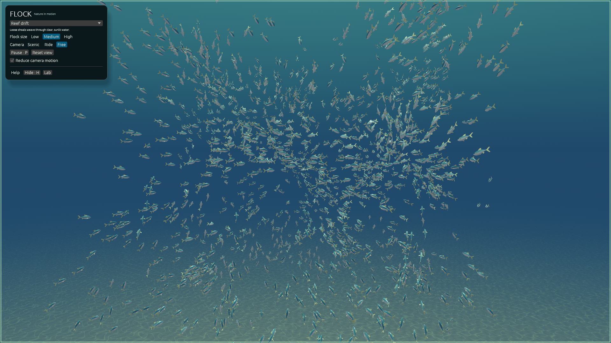

# 3D Boids simulation

Bird flocks, reef shoals and shark hunts in Rust and [Bevy](https://bevyengine.org/).
GPU flocking, animated animals and Scenic, Ride and Free cameras, on desktop and WebGPU.



## Run

Install [rustup](https://rustup.rs/) and the [system prerequisites](docs/new-machine-setup.md).
The repository pins the Rust toolchain.

```sh
CARGO_BUILD_JOBS=4 cargo run --release --locked
```

Choose **Sunset murmuration**, **Reef drift** or **Shark hunt** and a flock size.
Open **Lab** for simulation settings, CPU reference modes, custom models and up to one million GPU boids.

## Controls

- Right-drag to orbit, middle-drag to pan, scroll to zoom.
- **P** pauses; **H** hides the interface.
- **B** cycles Chase, First person and Off; **N** picks another animal.
- In Shark hunt, **Ride with → Fish / Shark** chooses your subject.

## More

- [Full guide](docs/reference.md): scenes, controls, models and advanced settings.
- [Browser and Docker setup](docs/web-delivery.md): WebGPU over HTTPS or localhost.
- [Development and tests](docs/reference.md#development) · [Performance](docs/reference.md#performance).
- [Project history](docs/reference.md#project-history) · [Plans and known limits](plans/STATUS.md).
